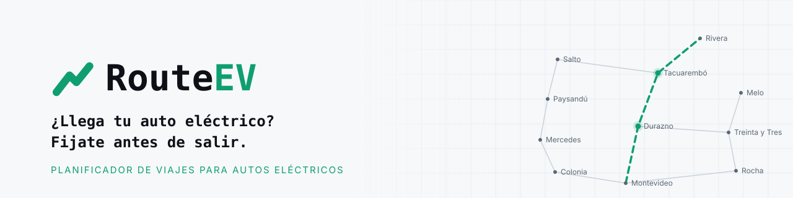

  <picture>
    <source media="(prefers-color-scheme: dark)" srcset="./assets/banner-dark.svg">
    
  </picture>

  
  
  

## El problema

Manejar un auto eléctrico en Uruguay todavía exige planificar a mano: ¿llego con esta batería?, ¿dónde cargo?, ¿ese cargador es compatible con mi auto? La autonomía de fábrica casi nunca coincide con la real, y la información de los cargadores está repartida entre operadores.

## Qué hace RouteEV

**RouteEV calcula el viaje completo para tu auto eléctrico**: la ruta, la batería con la que llegás a cada punto y las paradas de carga que hacen falta, sobre la red vial real del país.

| | |
|---|---|
| 🗺️ **Rutas con paradas de carga** | Elige dónde cargar según tu modelo, la batería con la que salís y el margen que querés al llegar. Modos rápido, eficiente y económico. |
| 🔌 **Todos los cargadores en un mapa** | Los cargadores públicos y privados del país, con potencia, conectores, fotos, reseñas y el estado que reporta la comunidad. |
| 🚗 **Pensado para cada auto** | Catálogo de modelos con consumo y autonomía reales, no solo los de fábrica. |
| 📊 **Showroom** | Compará autos eléctricos en viajes reales entre ciudades de Uruguay, antes de comprar. |
| 📍 **Viaje en vivo** | Seguimiento del viaje con la batería estimada en cada momento y peajes calculados. |

<b><a href="https://routeev.uy">Probalo en routeev.uy →</a></b>

## En números

<table>
  <tr>
    <td align="center"><h3>261</h3>cargadores</td>
    <td align="center"><h3>8</h3>operadores</td>
    <td align="center"><h3>587</h3>modelos de autos</td>
    <td align="center"><h3>19</h3>departamentos</td>
  </tr>
</table>

## Tecnología

Motor de ruteo propio sobre [Valhalla](https://github.com/valhalla/valhalla) y datos de [OpenStreetMap](https://www.openstreetmap.org), con búsqueda A* que modela la batería tramo a tramo.

  
  
  
  
  

## Equipo

Somos tres cofundadores de Montevideo:

**Eduardo Monzón** · **Matías Filgueiras** · **Lautaro Álvarez**

## Contacto

📧 [contacto@routeev.uy](mailto:contacto@routeev.uy) · 🌐 [routeev.uy](https://routeev.uy)

Datos viales © colaboradores de OpenStreetMap (ODbL).
